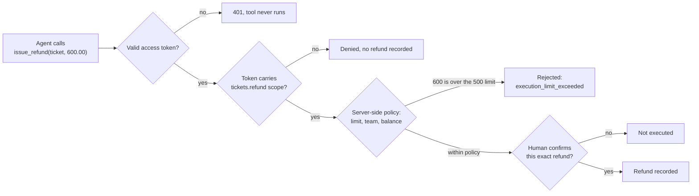

## Özgür Güler

**AI architect. I design agents, the tools they call, and the controls that decide what an agent is allowed to do, on Amazon Bedrock / AgentCore and Azure AI Foundry.**

These days I build agents and the tools they call. I got here through infrastructure: service-provider networks at Cisco, low-latency trading networks in London at J.P. Morgan and Automat (part of Citadel), then cloud architecture at AWS and enterprise AI at Microsoft. One question I keep coming back to is what happens when an agent asks to do something it shouldn’t.

### What happens when an agent tries to issue a refund above its limit?

It is refused on the tool server, before a person is ever asked to approve it. The limit is not in the prompt, so the model cannot talk its way past it. The [policy](https://github.com/ozgurgulerx/production-agent-platform/blob/main/Agent-Build-01-Fundamentals/S03-AI-Agents-Tools-and-MCP/S03.03-MCP-OAuth2.1/src/check_refund_policy.py) is under thirty lines, the [tool](https://github.com/ozgurgulerx/production-agent-platform/blob/main/Agent-Build-01-Fundamentals/S03-AI-Agents-Tools-and-MCP/S03.03-MCP-OAuth2.1/src/server.py) checks scope before and after the human step, and [this test](https://github.com/ozgurgulerx/production-agent-platform/blob/main/Agent-Build-01-Fundamentals/S03-AI-Agents-Tools-and-MCP/S03.03-MCP-OAuth2.1/tests/test_refund_above_execution_limit_is_rejected.py) is the question above.

### Selected work

| | What it is | Where it stands |
| --- | --- | --- |
| **[MCP tools behind OAuth 2.1](https://github.com/ozgurgulerx/production-agent-platform/tree/main/Agent-Build-01-Fundamentals/S03-AI-Agents-Tools-and-MCP/S03.03-MCP-OAuth2.1)** | An MCP server for support tickets and refunds: JWT validation, a scope per tool, server-side policy on simulated refunds, and human confirmation before the refund is recorded. | 119 tests passing. Live refund denial and confirmation checks against the authorisation server are still to do. |
| **[Amazon Bedrock and AgentCore](https://github.com/ozgurgulerx/aws-bedrock-agentcore)** | A Bedrock Converse client with [offline tests](https://github.com/ozgurgulerx/aws-bedrock-agentcore/blob/main/tests/test_bedrock_quickstart.py) for request construction and error handling, and an [AgentCore architecture walkthrough](https://github.com/ozgurgulerx/aws-bedrock-agentcore/blob/main/skills/mindmap/references/agentcore-example.md) for an order-support agent. | In build. The agent and its tools on AgentCore come next; live inference is not yet verified. |
| **[Continuous evaluation on Azure AI Foundry](https://github.com/ozgurgulerx/azure-foundry-cont-eval)** | A harness that schedules agent evaluations, sends controlled traffic and [checks that evaluation runs appear](https://github.com/ozgurgulerx/azure-foundry-cont-eval/blob/main/scripts/verify_evaluation.py). | Working harness, used as a release-gate pattern. |
| **[Fund analysis RAG with PII controls](https://github.com/ozgurgulerx/pii-fund-rag)** | A question-answering app over SEC N-PORT fund holdings and IMF outlook data: cited answers, PII detection in front of the model, a Next.js front end and a Python back end. | Deployed on Azure with GitHub Actions workflows for back end, front end, database migration and health checks. |
| **[Hosted agent on Azure AI Foundry](https://github.com/ozgurgulerx/foundry-demo)** | A workshop that takes a local Agent Framework script to a hosted agent: grounded knowledge, OpenTelemetry tracing, Entra Agent ID with Conditional Access, and Logic Apps as MCP tools behind the APIM AI Gateway. | Workshop material, run with customers. |
| **[Durable agent harnesses](https://github.com/ozgurgulerx/af-durable-harness-examples)** | Four runnable examples on Azure Functions: durable hosting, sequential orchestration, human approval with timeout and resume, and a persistent goal loop. | Runnable; accompanies the published article. |

Also: [presidio-pii-ozg](https://github.com/ozgurgulerx/presidio-pii-ozg) (a FastAPI service that detects and redacts PII before text reaches a model, with Docker and a deploy workflow), [inference-engineering](https://github.com/ozgurgulerx/inference-engineering) (notes and GPU experiments on LLM serving) and [agent-framework-ozg](https://github.com/ozgurgulerx/agent-framework-ozg) (workshop samples for Microsoft Agent Framework).

### Writing

- [Agent Governance on Microsoft Foundry, Part II](https://medium.com/microsoft/agent-governance-on-microsoft-foundry-part-ii-your-own-mcp-server-the-agents-own-identity-and-3bcbc331907f) — What changes when an agent gets its own identity and an Entra app role for a custom MCP tool.
- [Building Production AI with Microsoft’s Agent Framework](https://medium.com/microsoftazure/building-production-ai-with-microsofts-agent-framework-credit-underwriting-case-study-a40d8335d4ed) — A credit-underwriting case study.
- [Fixing Sparse Retrieval with RAPTOR on Azure AI Search](https://medium.com/microsoftazure/fixing-sparse-retrieval-with-raptor-on-azure-ai-search-4d540dd3bd43) — Tree-structured retrieval when chunks alone miss the answer.
- [Context Engineering with Microsoft Agent Framework’s Context Provider API](https://medium.com/microsoftazure/context-engineering-with-microsoft-agent-frameworks-context-provider-api-dcf083daa8be)
- [Tackle Complex LLM Decision-Making with Language Agent Tree Search (LATS) and GPT-4o](https://medium.com/data-science/tackle-complex-llm-decision-making-with-language-agent-tree-search-lats-gpt4-o-0bc648c46ea4) — Towards Data Science

### Background

- **Microsoft** — AI Hub solution engineer: use-case workshops, AI prototypes and deployment workshops with enterprise customers. Before that, cloud and AI tech lead for AI-core startups.
- **AWS** — Solutions architect, first for telcos, then for startups.
- **Cisco** — Principal system architect for service-provider core and data-centre networks, including Segment Routing / SRv6.
- **J.P. Morgan and Automat (part of Citadel)** — Low-latency trading networks and multicast market data.

Talks and workshop material are on [ozgurguler.org/talks](https://ozgurguler.org/talks/).

[Website](https://ozgurguler.org/) · [LinkedIn](https://www.linkedin.com/in/ozguler/)
